# ERD FINAL — OBAT HAUS OPERATIONAL SYSTEM MANAGEMENT
**Dokumen:** Spesifikasi Entity Relationship Diagram (ERD) Final & Kamus Data  
**Versi:** 1.0 — Phase 1 Foundation & Database Design  
**Target Database:** PostgreSQL 15+ (Supabase)  
**Status:** Rancangan Final (Menunggu Persetujuan Owner — Belum Dijalankan ke Database)

---

## 1. Prinsip Perancangan Database

1. **Preservasi 100% Skema Eksisting**: Sembilan tabel inti dari aplikasi Cafe POS sebelumnya (`store_settings`, `profiles`, `categories`, `products`, `transactions`, `transaction_items`, `expense_categories`, `operating_expenses`, `audit_logs`) dipertahankan secara utuh dan diperluas (*extended*) tanpa menghapus kolom lama sehingga tidak terjadi *breaking changes*.
2. **Multi-Outlet & Multi-Gudang Independen**: Mendukung 7 outlet awal, 1 gudang pusat, dan fleksibel untuk penambahan outlet tanpa mengubah struktur database (*scalable*). Stok setiap lokasi terisolasi secara ketat.
3. **Pemisahan Tegas Produk Menu vs Bahan Baku**:
   * **Master Produk Menu (`products`)**: Menu minuman/makanan siap jual ke pelanggan di kasir POS.
   * **Master Bahan Baku (`raw_materials`)**: Bahan mentah/stok gudang (biji kopi, susu, sirup, gula aren, cup, sedotan).
4. **Recipe Engine & Snapshot HPP Transaksi**:
   * Setiap menu dihubungkan ke bahan baku melalui resep terversi (`recipes`, `recipe_versions`, `recipe_items`).
   * Setiap transaksi penjualan kasir mencatat snapshot resep dan HPP saat transaksi terjadi. Perubahan harga bahan atau resep di masa depan tidak mengubah histori transaksi masa lalu.
5. **Stock Ledger (Double-Entry Inventory Accounting)**:
   * Saldo stok tidak diubah secara sembarangan (*no direct arbitrary update*).
   * Seluruh penambahan dan pengurangan wajib memiliki dokumen referensi (PO Supplier, Penjualan POS, Distribusi In-Transit, Retur, atau Stok Opname yang disetujui Owner).
6. **Mekanisme In-Transit Inventory**:
   * Pengiriman bahan dari gudang ke outlet memiliki status *in-transit*. Stok gudang berkurang saat dikirim, namun stok outlet baru bertambah saat diterima dan dihitung aktual oleh kasir.
7. **Shift Kasir Wajib (*Mandatory Cashier Shift*)**:
   * Transaksi POS wajib terikat pada shift aktif untuk rekonsiliasi kas (modal awal + penerimaan tunai - pengeluaran = kas seharusnya vs uang fisik).
8. **Immutability & Anti-Fraud**:
   * Transaksi yang sudah diposting tidak dapat di-edit atau di-hard-delete oleh kasir maupun operator gudang.
   * Audit log bersifat *append-only*.

---

## 2. Diagram ERD Sistem Lengkap (Mermaid)

```mermaid
erDiagram
    ORGANIZATIONS ||--o{ OUTLETS : owns
    ORGANIZATIONS ||--o{ WAREHOUSES : owns
    ORGANIZATIONS ||--o{ STORE_SETTINGS : configures

    OUTLETS ||--o{ PROFILES : employs
    OUTLETS ||--o{ OUTLET_PRODUCTS : sells
    OUTLETS ||--o{ OUTLET_PRODUCT_PRICES : prices
    OUTLETS ||--o{ INVENTORY_BALANCES : holds_stock
    OUTLETS ||--o{ CASHIER_SHIFTS : operates
    OUTLETS ||--o{ TRANSACTIONS : records
    OUTLETS ||--o{ OUTLET_PURCHASE_ORDERS : requests
    OUTLETS ||--o{ OUTLET_RECEIPTS : receives_dispatch
    OUTLETS ||--o{ RETURN_REQUESTS : returns_items
    OUTLETS ||--o{ OPERATING_EXPENSES : incurs

    WAREHOUSES ||--o{ PROFILES : assigns_operators
    WAREHOUSES ||--o{ INVENTORY_BALANCES : stores_bulk_stock
    WAREHOUSES ||--o{ SUPPLIER_PURCHASE_ORDERS : procures
    WAREHOUSES ||--o{ SUPPLIER_RECEIPTS : receives_goods
    WAREHOUSES ||--o{ WAREHOUSE_DISPATCHES : ships_to_outlets
    WAREHOUSES ||--o{ RETURN_INSPECTIONS : inspects_returns
    WAREHOUSES ||--o{ STOCK_OPNAMES : conducts_audits
    WAREHOUSES ||--o{ OPERATING_EXPENSES : incurs

    ROLES ||--o{ ROLE_PERMISSIONS : defines
    PERMISSIONS ||--o{ ROLE_PERMISSIONS : assigned_to
    ROLES ||--o{ PROFILES : has_role
    PROFILES ||--o{ USER_OUTLET_ASSIGNMENTS : assigned_location
    PROFILES ||--o{ CASHIER_SHIFTS : opens_shift
    PROFILES ||--o{ TRANSACTIONS : serves
    PROFILES ||--o{ APPROVAL_REQUESTS : submits
    PROFILES ||--o{ APPROVAL_ACTIONS : approves_or_rejects
    PROFILES ||--o{ AUDIT_LOGS : triggers

    CATEGORIES ||--o{ PRODUCTS : categorizes
    PRODUCTS ||--o{ OUTLET_PRODUCTS : available_at
    PRODUCTS ||--o{ OUTLET_PRODUCT_PRICES : custom_prices
    PRODUCTS ||--o{ RECIPES : defined_by
    PRODUCTS ||--o{ TRANSACTION_ITEMS : purchased_in

    RAW_MATERIAL_CATEGORIES ||--o{ RAW_MATERIALS : categorizes
    UNITS ||--o{ RAW_MATERIALS : base_unit
    UNITS ||--o{ UNIT_CONVERSIONS : from_unit
    UNITS ||--o{ UNIT_CONVERSIONS : to_unit
    RAW_MATERIALS ||--o{ RECIPE_ITEMS : ingredient_in
    RAW_MATERIALS ||--o{ INVENTORY_BALANCES : tracked_in
    RAW_MATERIALS ||--o{ STOCK_LEDGER : movements
    RAW_MATERIALS ||--o{ SUPPLIER_PURCHASE_ORDER_ITEMS : ordered_from_supplier
    RAW_MATERIALS ||--o{ OUTLET_PURCHASE_ORDER_ITEMS : requested_by_outlet

    RECIPES ||--o{ RECIPE_VERSIONS : versioned_as
    RECIPE_VERSIONS ||--o{ RECIPE_ITEMS : contains

    INVENTORY_LOCATIONS ||--o{ INVENTORY_BALANCES : location_balance
    INVENTORY_LOCATIONS ||--o{ STOCK_LEDGER : location_movement

    SUPPLIERS ||--o{ SUPPLIER_PURCHASE_ORDERS : receives_po
    SUPPLIER_PURCHASE_ORDERS ||--o{ SUPPLIER_PURCHASE_ORDER_ITEMS : items
    SUPPLIER_PURCHASE_ORDERS ||--o{ SUPPLIER_RECEIPTS : fulfilled_by
    SUPPLIER_RECEIPTS ||--o{ SUPPLIER_RECEIPT_ITEMS : received_items

    OUTLET_PURCHASE_ORDERS ||--o{ OUTLET_PURCHASE_ORDER_ITEMS : items
    OUTLET_PURCHASE_ORDERS ||--o{ WAREHOUSE_DISPATCHES : fulfilled_by
    WAREHOUSE_DISPATCHES ||--o{ WAREHOUSE_DISPATCH_ITEMS : dispatched_items
    WAREHOUSE_DISPATCHES ||--o{ OUTLET_RECEIPTS : confirmed_by
    OUTLET_RECEIPTS ||--o{ OUTLET_RECEIPT_ITEMS : confirmed_items

    RETURN_REQUESTS ||--o{ RETURN_REQUEST_ITEMS : items
    RETURN_REQUESTS ||--o{ RETURN_INSPECTIONS : inspected_by

    STOCK_OPNAMES ||--o{ STOCK_OPNAME_ITEMS : counts
    STOCK_OPNAMES ||--o{ STOCK_ADJUSTMENTS : generates

    CASHIER_SHIFTS ||--o{ SHIFT_CASH_MOVEMENTS : logs_cash
    CASHIER_SHIFTS ||--o{ TRANSACTIONS : encompasses

    TRANSACTIONS ||--o{ TRANSACTION_ITEMS : contains
    TRANSACTIONS ||--o{ TRANSACTION_CORRECTIONS : corrected_by

    EXPENSE_CATEGORIES ||--o{ OPERATING_EXPENSES : categorizes
    OPERATING_EXPENSES ||--o{ EXPENSE_ATTACHMENTS : attaches_receipts

    APPROVAL_REQUESTS ||--o{ APPROVAL_ACTIONS : records_decisions
```

---

## 3. Kamus Data & Definisi Tabel Terperinci

### 3.1 Domain Organisasi & Multi-Lokasi

#### 1. `organizations` (Organisasi Bisnis Induk)
Menyimpan identitas entitas bisnis Obat Haus.
* `id` (UUID, PK, default `gen_random_uuid()`)
* `name` (TEXT, NOT NULL) — Contoh: 'Obat Haus Indonesia'
* `code` (TEXT, UNIQUE, NOT NULL) — Contoh: 'OBAT_HAUS'
* `created_at` (TIMESTAMPTZ, NOT NULL, DEFAULT now())
* `updated_at` (TIMESTAMPTZ, NOT NULL, DEFAULT now())

#### 2. `outlets` (Master Cabang / Outlet)
Menyimpan seluruh cabang outlet Obat Haus (7 outlet awal + ekspansi cabang baru).
* `id` (UUID, PK, default `gen_random_uuid()`)
* `organization_id` (UUID, FK -> `organizations.id`, NOT NULL)
* `code` (TEXT, UNIQUE, NOT NULL) — Contoh: 'OUT-01', 'OUT-02'
* `name` (TEXT, NOT NULL) — Contoh: 'Obat Haus - Ahmad Yani'
* `address` (TEXT, NOT NULL)
* `phone` (TEXT)
* `email` (TEXT)
* `invoice_prefix` (TEXT, NOT NULL, DEFAULT 'INV-01')
* `invoice_counter` (BIGINT, NOT NULL, DEFAULT 1000)
* `receipt_header` (TEXT)
* `receipt_footer` (TEXT)
* `is_active` (BOOLEAN, NOT NULL, DEFAULT true)
* `created_at` (TIMESTAMPTZ, NOT NULL, DEFAULT now())
* `updated_at` (TIMESTAMPTZ, NOT NULL, DEFAULT now())

#### 3. `warehouses` (Master Gudang Pusat)
Menyimpan data gudang pusat Obat Haus tempat penampungan pengadaan supplier dan distribusi.
* `id` (UUID, PK, default `gen_random_uuid()`)
* `organization_id` (UUID, FK -> `organizations.id`, NOT NULL)
* `code` (TEXT, UNIQUE, NOT NULL) — Contoh: 'WH-CENTRAL'
* `name` (TEXT, NOT NULL) — Contoh: 'Gudang Pusat Obat Haus'
* `address` (TEXT, NOT NULL)
* `phone` (TEXT)
* `is_active` (BOOLEAN, NOT NULL, DEFAULT true)
* `created_at` (TIMESTAMPTZ, NOT NULL, DEFAULT now())
* `updated_at` (TIMESTAMPTZ, NOT NULL, DEFAULT now())

---

### 3.2 Domain Pengguna, Role & Hak Akses (RBAC)

Sistem menggunakan tepat 3 role:
1. `admin` — Admin sekaligus Owner/Pemilik Obat Haus (kewenangan penuh seluruh sistem & semua outlet).
2. `cashier` — Kasir Outlet (terikat pada outlet yang ditugaskan).
3. `warehouse_operator` — Operator Gudang (terikat pada gudang pusat).

#### 4. `roles` (Master Role Sistem)
* `id` (TEXT, PK) — `'admin'`, `'cashier'`, `'warehouse_operator'`
* `name` (TEXT, NOT NULL) — 'Admin (Owner)', 'Kasir / Staf Outlet', 'Operator Gudang'
* `description` (TEXT)
* `created_at` (TIMESTAMPTZ, NOT NULL, DEFAULT now())

#### 5. `permissions` (Daftar Kewenangan Granular)
* `id` (TEXT, PK) — Contoh: `'pos.transact'`, `'po_supplier.create'`, `'po_supplier.approve'`, `'inventory.adjust'`
* `module` (TEXT, NOT NULL) — 'pos', 'inventory', 'procurement', 'distribution', 'finance', 'master'
* `description` (TEXT, NOT NULL)

#### 6. `role_permissions` (Relasi Role ke Permission)
* `role_id` (TEXT, FK -> `roles.id`, NOT NULL)
* `permission_id` (TEXT, FK -> `permissions.id`, NOT NULL)
* *Primary Key:* `(role_id, permission_id)`

#### 7. `profiles` (Tabel Eksisting — Diperluas)
Menyimpan profil akun pengguna dan kredensial login.
* `id` (UUID, PK, default `gen_random_uuid()`)
* `email` (TEXT, NOT NULL)
* `username` (TEXT, UNIQUE) — Digunakan untuk login cepat kasir/staf
* `full_name` (TEXT, NOT NULL)
* `role` (TEXT, NOT NULL, CHECK in `'admin'`, `'cashier'`, `'warehouse_operator'`)
* `is_active` (BOOLEAN, NOT NULL, DEFAULT true)
* `password` (TEXT) — Kredensial password/PIN terenkripsi
* `primary_outlet_id` (UUID, FK -> `outlets.id`, NULLABLE) — Outlet tugas default
* `primary_warehouse_id` (UUID, FK -> `warehouses.id`, NULLABLE) — Gudang tugas default
* `created_at` (TIMESTAMPTZ, NOT NULL, DEFAULT now())
* `updated_at` (TIMESTAMPTZ, NOT NULL, DEFAULT now())

#### 8. `user_outlet_assignments` (Penetapan Pengguna ke Lokasi)
Mendukung staf atau kasir yang diperbantukan di beberapa cabang outlet tertentu.
* `id` (UUID, PK, default `gen_random_uuid()`)
* `user_id` (UUID, FK -> `profiles.id`, NOT NULL)
* `outlet_id` (UUID, FK -> `outlets.id`, NULLABLE)
* `warehouse_id` (UUID, FK -> `warehouses.id`, NULLABLE)
* `is_active` (BOOLEAN, NOT NULL, DEFAULT true)
* `created_at` (TIMESTAMPTZ, NOT NULL, DEFAULT now())

---

### 3.3 Domain Master Produk Menu & Kategori

#### 9. `categories` (Tabel Eksisting — Dipertahankan)
Kategori produk siap jual di kasir POS.
* `id` (UUID, PK, default `gen_random_uuid()`)
* `name` (TEXT, NOT NULL) — Contoh: 'Signature Coffee', 'Non-Coffee', 'Milk Series', 'Snacks'
* `slug` (TEXT, UNIQUE, NOT NULL)
* `description` (TEXT)
* `icon_name` (TEXT)
* `sort_order` (INTEGER, NOT NULL, DEFAULT 0)
* `is_active` (BOOLEAN, NOT NULL, DEFAULT true)
* `created_at` (TIMESTAMPTZ, NOT NULL, DEFAULT now())
* `updated_at` (TIMESTAMPTZ, NOT NULL, DEFAULT now())

#### 10. `products` (Tabel Eksisting — Dipertahankan & Diekspansi)
Master produk menu minuman & makanan jadi.
* `id` (UUID, PK, default `gen_random_uuid()`)
* `category_id` (UUID, FK -> `categories.id`, NOT NULL)
* `name` (TEXT, NOT NULL)
* `sku` (TEXT, UNIQUE)
* `description` (TEXT)
* `image_url` (TEXT)
* `base_selling_price` (NUMERIC(12,2), NOT NULL, CHECK > 0) — Menggantikan `selling_price` default
* `standard_hpp` (NUMERIC(12,2), NOT NULL, DEFAULT 0) — Estimasi HPP acuan
* `is_active` (BOOLEAN, NOT NULL, DEFAULT true)
* `created_at` (TIMESTAMPTZ, NOT NULL, DEFAULT now())
* `updated_at` (TIMESTAMPTZ, NOT NULL, DEFAULT now())

#### 11. `outlet_products` (Ketersediaan Menu per Outlet)
Mengatur produk mana saja yang aktif dan tersedia untuk dijual di masing-masing cabang.
* `id` (UUID, PK, default `gen_random_uuid()`)
* `outlet_id` (UUID, FK -> `outlets.id`, NOT NULL)
* `product_id` (UUID, FK -> `products.id`, NOT NULL)
* `is_available` (BOOLEAN, NOT NULL, DEFAULT true)
* `created_at` (TIMESTAMPTZ, NOT NULL, DEFAULT now())
* *Unique Constraint:* `(outlet_id, product_id)`

#### 12. `outlet_product_prices` (Harga Kustom Menu per Outlet)
Mendukung kebijakan harga berbeda di masing-masing outlet jika ditetapkan Owner.
* `id` (UUID, PK, default `gen_random_uuid()`)
* `outlet_id` (UUID, FK -> `outlets.id`, NOT NULL)
* `product_id` (UUID, FK -> `products.id`, NOT NULL)
* `custom_selling_price` (NUMERIC(12,2), NOT NULL, CHECK > 0)
* `effective_date` (DATE, NOT NULL, DEFAULT CURRENT_DATE)
* `created_at` (TIMESTAMPTZ, NOT NULL, DEFAULT now())
* *Unique Constraint:* `(outlet_id, product_id, effective_date)`

---

### 3.4 Domain Master Bahan Baku, Satuan & Konversi

#### 13. `raw_material_categories` (Kategori Bahan Mentah)
* `id` (UUID, PK, default `gen_random_uuid()`)
* `name` (TEXT, NOT NULL) — Contoh: 'Biji Kopi', 'Susu & Dairy', 'Sirup & Pemanis', 'Kemasan / Packaging'
* `description` (TEXT)
* `created_at` (TIMESTAMPTZ, NOT NULL, DEFAULT now())

#### 14. `units` (Master Satuan Pengukuran)
* `id` (TEXT, PK) — Contoh: `'gram'`, `'ml'`, `'kg'`, `'liter'`, `'pcs'`, `'pack'`, `'karton'`
* `name` (TEXT, NOT NULL)
* `symbol` (TEXT, NOT NULL)
* `type` (TEXT, NOT NULL, CHECK in `'weight'`, `'volume'`, `'quantity'`)

#### 15. `unit_conversions` (Konversi Satuan Pembelian ke Pemakaian)
* `id` (UUID, PK, default `gen_random_uuid()`)
* `from_unit_id` (TEXT, FK -> `units.id`, NOT NULL) — Misal: 'kg'
* `to_unit_id` (TEXT, FK -> `units.id`, NOT NULL) — Misal: 'gram'
* `multiplier` (NUMERIC(12,4), NOT NULL) — 1000.0000
* *Unique Constraint:* `(from_unit_id, to_unit_id)`

#### 16. `raw_materials` (Master Bahan Baku)
* `id` (UUID, PK, default `gen_random_uuid()`)
* `category_id` (UUID, FK -> `raw_material_categories.id`, NOT NULL)
* `sku` (TEXT, UNIQUE, NOT NULL) — Contoh: 'RAW-COF-01', 'RAW-SYR-VAN'
* `name` (TEXT, NOT NULL) — Contoh: 'Biji Kopi House Blend Arabika', 'Fresh Milk Plain', 'Cup Dingin 16oz'
* `base_unit_id` (TEXT, FK -> `units.id`, NOT NULL) — Satuan pemakaian resep (gram, ml, pcs)
* `purchase_unit_id` (TEXT, FK -> `units.id`, NOT NULL) — Satuan pembelian supplier (kg, liter, karton)
* `minimum_stock_alert` (NUMERIC(12,2), NOT NULL, DEFAULT 0)
* `last_purchase_price` (NUMERIC(12,2), DEFAULT 0)
* `average_cost` (NUMERIC(12,2), DEFAULT 0) — Dasar kalkulasi Weighted Average
* `is_active` (BOOLEAN, NOT NULL, DEFAULT true)
* `created_at` (TIMESTAMPTZ, NOT NULL, DEFAULT now())
* `updated_at` (TIMESTAMPTZ, NOT NULL, DEFAULT now())

---

### 3.5 Domain Resep & Recipe Versioning

#### 17. `recipes` (Header Resep Menu)
* `id` (UUID, PK, default `gen_random_uuid()`)
* `product_id` (UUID, FK -> `products.id`, NOT NULL)
* `outlet_id` (UUID, FK -> `outlets.id`, NULLABLE) — NULL = Resep standar global, Isi = Penyesuaian khusus outlet
* `status` (TEXT, NOT NULL, CHECK in `'active'`, `'archived'`, `'draft'`) DEFAULT 'active'
* `created_at` (TIMESTAMPTZ, NOT NULL, DEFAULT now())
* `updated_at` (TIMESTAMPTZ, NOT NULL, DEFAULT now())

#### 18. `recipe_versions` (Riwayat Versi Resep)
Mencatat versi resep agar transaksi lama tidak berubah saat resep diperbarui di masa mendatang.
* `id` (UUID, PK, default `gen_random_uuid()`)
* `recipe_id` (UUID, FK -> `recipes.id`, NOT NULL)
* `version_number` (INTEGER, NOT NULL) — 1, 2, 3...
* `effective_from` (TIMESTAMPTZ, NOT NULL, DEFAULT now())
* `effective_until` (TIMESTAMPTZ, NULLABLE)
* `notes` (TEXT) — Contoh: 'Peningkatan takaran espresso dari 16g ke 18g'
* `created_by` (UUID, FK -> `profiles.id`, NOT NULL)
* `created_at` (TIMESTAMPTZ, NOT NULL, DEFAULT now())

#### 19. `recipe_items` (Bahan Baku & Takaran dalam Resep)
* `id` (UUID, PK, default `gen_random_uuid()`)
* `recipe_version_id` (UUID, FK -> `recipe_versions.id`, NOT NULL)
* `raw_material_id` (UUID, FK -> `raw_materials.id`, NOT NULL)
* `quantity` (NUMERIC(12,4), NOT NULL, CHECK > 0) — Takaran bahan
* `unit_id` (TEXT, FK -> `units.id`, NOT NULL) — Satuan takaran (harus kompatibel dengan `base_unit`)
* `notes` (TEXT)

---

### 3.6 Domain Inventory, Stock Ledger & Opname

#### 20. `inventory_locations` (Lokasi Fisik / Virtual Penyimpanan)
* `id` (UUID, PK, default `gen_random_uuid()`)
* `location_type` (TEXT, NOT NULL, CHECK in `'warehouse'`, `'outlet'`, `'in_transit'`)
* `outlet_id` (UUID, FK -> `outlets.id`, NULLABLE)
* `warehouse_id` (UUID, FK -> `warehouses.id`, NULLABLE)
* `name` (TEXT, NOT NULL)
* *Unique Constraint:* `(location_type, outlet_id, warehouse_id)`

#### 21. `inventory_balances` (Saldo Stok Saat Ini per Lokasi)
Menyimpan saldo agregat cepat (*cache*) yang selalu dapat diverifikasi ulang terhadap `stock_ledger`.
* `id` (UUID, PK, default `gen_random_uuid()`)
* `location_id` (UUID, FK -> `inventory_locations.id`, NOT NULL)
* `raw_material_id` (UUID, FK -> `raw_materials.id`, NOT NULL)
* `current_quantity` (NUMERIC(12,4), NOT NULL, DEFAULT 0)
* `reserved_quantity` (NUMERIC(12,4), NOT NULL, DEFAULT 0) — Stok yang sudah di-pack untuk distribusi
* `last_recalculated_at` (TIMESTAMPTZ, NOT NULL, DEFAULT now())
* *Unique Constraint:* `(location_id, raw_material_id)`

#### 22. `stock_ledger` (Buku Besar Pergerakan Stok — Immutable)
Mencatat seluruh mutasi debit dan kredit stok. **Tidak ada baris yang boleh diubah atau dihapus**.
* `id` (UUID, PK, default `gen_random_uuid()`)
* `document_number` (TEXT, NOT NULL) — Nomor PO, invoice penjualan, surat jalan, atau nomor opname
* `movement_type` (TEXT, NOT NULL, CHECK in:
  * `'supplier_receipt'` (Masuk dari supplier ke gudang)
  * `'dispatch_to_transit'` (Keluar dari gudang menuju perjalanan)
  * `'transit_to_outlet'` (Masuk ke outlet dari perjalanan)
  * `'pos_consumption'` (Pemakaian bahan otomatis dari transaksi kasir)
  * `'stock_opname_adjustment'` (Penyesuaian selisih fisik)
  * `'return_to_warehouse'` (Retur dari outlet ke gudang)
  * `'waste_damaged'` (Barang tumpah / rusak / kedaluwarsa)
* `from_location_id` (UUID, FK -> `inventory_locations.id`, NULLABLE)
* `to_location_id` (UUID, FK -> `inventory_locations.id`, NULLABLE)
* `raw_material_id` (UUID, FK -> `raw_materials.id`, NOT NULL)
* `quantity` (NUMERIC(12,4), NOT NULL, CHECK > 0)
* `unit_id` (TEXT, FK -> `units.id`, NOT NULL)
* `unit_cost` (NUMERIC(12,2), DEFAULT 0) — Biaya perolehan per satuan saat mutasi terjadi
* `total_cost` (NUMERIC(12,2), DEFAULT 0)
* `reference_table` (TEXT, NOT NULL) — 'transactions', 'warehouse_dispatches', 'supplier_receipts', dll
* `reference_id` (UUID, NOT NULL)
* `created_by` (UUID, FK -> `profiles.id`, NOT NULL)
* `notes` (TEXT)
* `created_at` (TIMESTAMPTZ, NOT NULL, DEFAULT now())

#### 23. `stock_opnames` (Sesi Hitung Fisik Bahan Baku)
* `id` (UUID, PK, default `gen_random_uuid()`)
* `opname_number` (TEXT, UNIQUE, NOT NULL) — Contoh: 'SOP-WH-261102-001'
* `location_id` (UUID, FK -> `inventory_locations.id`, NOT NULL)
* `conducted_by` (UUID, FK -> `profiles.id`, NOT NULL)
* `status` (TEXT, NOT NULL, CHECK in `'draft'`, `'submitted'`, `'approved'`, `'rejected'`) DEFAULT 'draft'
* `submitted_at` (TIMESTAMPTZ)
* `approved_by` (UUID, FK -> `profiles.id`, NULLABLE)
* `approved_at` (TIMESTAMPTZ)
* `approval_notes` (TEXT)
* `created_at` (TIMESTAMPTZ, NOT NULL, DEFAULT now())

#### 24. `stock_opname_items` (Rincian Hitung Fisik per Bahan)
* `id` (UUID, PK, default `gen_random_uuid()`)
* `opname_id` (UUID, FK -> `stock_opnames.id`, NOT NULL)
* `raw_material_id` (UUID, FK -> `raw_materials.id`, NOT NULL)
* `system_quantity` (NUMERIC(12,4), NOT NULL) — Stok menurut sistem
* `physical_quantity` (NUMERIC(12,4), NOT NULL) — Stok hitungan fisik di lapangan
* `difference_quantity` (NUMERIC(12,4), NOT NULL) — Selisih (`physical - system`)
* `unit_id` (TEXT, FK -> `units.id`, NOT NULL)
* `reason` (TEXT) — Keterangan penyebab selisih
* `created_at` (TIMESTAMPTZ, NOT NULL, DEFAULT now())

#### 25. `stock_adjustments` (Dokumen Penyesuaian Stok Resmi)
Diterbitkan otomatis hanya ketika hasil `stock_opnames` disetujui Owner.
* `id` (UUID, PK, default `gen_random_uuid()`)
* `adjustment_number` (TEXT, UNIQUE, NOT NULL)
* `opname_id` (UUID, FK -> `stock_opnames.id`, NOT NULL)
* `approved_by` (UUID, FK -> `profiles.id`, NOT NULL)
* `created_at` (TIMESTAMPTZ, NOT NULL, DEFAULT now())

---

### 3.7 Domain Supplier & Pengadaan Gudang

#### 26. `suppliers` (Master Supplier Bahan Baku)
Hanya dikelola oleh Owner.
* `id` (UUID, PK, default `gen_random_uuid()`)
* `code` (TEXT, UNIQUE, NOT NULL) — Contoh: 'SUP-COFFEE-01'
* `name` (TEXT, NOT NULL) — Contoh: 'PT Roastery Nusantara'
* `contact_person` (TEXT)
* `phone` (TEXT)
* `email` (TEXT)
* `address` (TEXT)
* `payment_terms` (TEXT) — Contoh: 'COD', 'Net 14', 'Net 30'
* `is_active` (BOOLEAN, NOT NULL, DEFAULT true)
* `created_at` (TIMESTAMPTZ, NOT NULL, DEFAULT now())

#### 27. `supplier_purchase_orders` (PO Pembelian ke Supplier)
Diajukan oleh Operator Gudang, wajib disetujui Owner.
* `id` (UUID, PK, default `gen_random_uuid()`)
* `po_number` (TEXT, UNIQUE, NOT NULL) — Contoh: 'PO-SUP-261102-001'
* `supplier_id` (UUID, FK -> `suppliers.id`, NOT NULL)
* `warehouse_id` (UUID, FK -> `warehouses.id`, NOT NULL)
* `created_by` (UUID, FK -> `profiles.id`, NOT NULL)
* `status` (TEXT, NOT NULL, CHECK in:
  * `'draft'`, `'submitted'`, `'approved'`, `'rejected'`, `'ordered'`, `'partially_received'`, `'completed'`, `'cancelled'`
* `subtotal` (NUMERIC(12,2), NOT NULL, DEFAULT 0)
* `tax_amount` (NUMERIC(12,2), NOT NULL, DEFAULT 0)
* `grand_total` (NUMERIC(12,2), NOT NULL, DEFAULT 0)
* `notes` (TEXT)
* `submitted_at` (TIMESTAMPTZ)
* `approved_by` (UUID, FK -> `profiles.id`, NULLABLE)
* `approved_at` (TIMESTAMPTZ)
* `approval_notes` (TEXT)
* `created_at` (TIMESTAMPTZ, NOT NULL, DEFAULT now())

#### 28. `supplier_purchase_order_items` (Rincian Item PO Supplier)
* `id` (UUID, PK, default `gen_random_uuid()`)
* `po_id` (UUID, FK -> `supplier_purchase_orders.id`, NOT NULL)
* `raw_material_id` (UUID, FK -> `raw_materials.id`, NOT NULL)
* `quantity_ordered` (NUMERIC(12,4), NOT NULL, CHECK > 0)
* `quantity_received` (NUMERIC(12,4), NOT NULL, DEFAULT 0)
* `unit_id` (TEXT, FK -> `units.id`, NOT NULL)
* `unit_price` (NUMERIC(12,2), NOT NULL, CHECK >= 0)
* `subtotal` (NUMERIC(12,2), NOT NULL, CHECK >= 0)

#### 29. `supplier_receipts` (Penerimaan Barang Fisik dari Supplier)
* `id` (UUID, PK, default `gen_random_uuid()`)
* `receipt_number` (TEXT, UNIQUE, NOT NULL) — Contoh: 'GRN-SUP-261102-001'
* `po_id` (UUID, FK -> `supplier_purchase_orders.id`, NOT NULL)
* `supplier_invoice_number` (TEXT) — Nomor surat jalan/faktur fisik supplier
* `received_by` (UUID, FK -> `profiles.id`, NOT NULL)
* `received_at` (TIMESTAMPTZ, NOT NULL, DEFAULT now())
* `proof_image_url` (TEXT) — Foto nota/bukti penerimaan fisik
* `notes` (TEXT)

#### 30. `supplier_receipt_items` (Rincian Aktual Penerimaan Supplier)
* `id` (UUID, PK, default `gen_random_uuid()`)
* `receipt_id` (UUID, FK -> `supplier_receipts.id`, NOT NULL)
* `raw_material_id` (UUID, FK -> `raw_materials.id`, NOT NULL)
* `quantity_received_actual` (NUMERIC(12,4), NOT NULL, CHECK >= 0)
* `quantity_damaged` (NUMERIC(12,4), NOT NULL, DEFAULT 0)
* `unit_id` (TEXT, FK -> `units.id`, NOT NULL)
* `notes` (TEXT)

---

### 3.8 Domain Permintaan Outlet, Distribusi & In-Transit

#### 31. `outlet_purchase_orders` (Permintaan Bahan Baku dari Outlet ke Gudang)
* `id` (UUID, PK, default `gen_random_uuid()`)
* `order_number` (TEXT, UNIQUE, NOT NULL) — Contoh: 'PO-OUT-01-261102-001'
* `outlet_id` (UUID, FK -> `outlets.id`, NOT NULL)
* `destination_location_id` (UUID, FK -> `inventory_locations.id`, NOT NULL)
* `created_by` (UUID, FK -> `profiles.id`, NOT NULL)
* `status` (TEXT, NOT NULL, CHECK in:
  * `'draft'`, `'submitted'`, `'processing'`, `'dispatched'`, `'partially_received'`, `'completed'`, `'rejected'`, `'cancelled'`
* `notes` (TEXT)
* `created_at` (TIMESTAMPTZ, NOT NULL, DEFAULT now())

#### 32. `outlet_purchase_order_items` (Rincian Permintaan Bahan Baku Outlet)
* `id` (UUID, PK, default `gen_random_uuid()`)
* `order_id` (UUID, FK -> `outlet_purchase_orders.id`, NOT NULL)
* `raw_material_id` (UUID, FK -> `raw_materials.id`, NOT NULL)
* `quantity_requested` (NUMERIC(12,4), NOT NULL, CHECK > 0)
* `quantity_approved` (NUMERIC(12,4), NOT NULL, DEFAULT 0)
* `quantity_dispatched` (NUMERIC(12,4), NOT NULL, DEFAULT 0)
* `quantity_received` (NUMERIC(12,4), NOT NULL, DEFAULT 0)
* `unit_id` (TEXT, FK -> `units.id`, NOT NULL)

#### 33. `warehouse_dispatches` (Surat Jalan & Pengiriman Gudang ke Outlet)
Ketika status dikirim: stok gudang pusat berkurang, stok *in-transit* bertambah.
* `id` (UUID, PK, default `gen_random_uuid()`)
* `dispatch_number` (TEXT, UNIQUE, NOT NULL) — Contoh: 'SJ-WH-261102-001'
* `outlet_order_id` (UUID, FK -> `outlet_purchase_orders.id`, NOT NULL)
* `origin_location_id` (UUID, FK -> `inventory_locations.id`, NOT NULL) — Gudang
* `in_transit_location_id` (UUID, FK -> `inventory_locations.id`, NOT NULL) — In-Transit
* `dispatched_by` (UUID, FK -> `profiles.id`, NOT NULL)
* `driver_name` (TEXT)
* `vehicle_plate` (TEXT)
* `status` (TEXT, NOT NULL, CHECK in `'in_transit'`, `'delivered'`, `'returned'`) DEFAULT 'in_transit'
* `proof_image_url` (TEXT)
* `dispatched_at` (TIMESTAMPTZ, NOT NULL, DEFAULT now())

#### 34. `warehouse_dispatch_items` (Rincian Bahan Baku yang Dikirim)
* `id` (UUID, PK, default `gen_random_uuid()`)
* `dispatch_id` (UUID, FK -> `warehouse_dispatches.id`, NOT NULL)
* `raw_material_id` (UUID, FK -> `raw_materials.id`, NOT NULL)
* `quantity_sent` (NUMERIC(12,4), NOT NULL, CHECK > 0)
* `unit_id` (TEXT, FK -> `units.id`, NOT NULL)

#### 35. `outlet_receipts` (Konfirmasi Penerimaan Aktual oleh Kasir / Staf Outlet)
Ketika dikonfirmasi: stok *in-transit* berkurang, stok outlet bertambah sesuai jumlah aktual.
* `id` (UUID, PK, default `gen_random_uuid()`)
* `receipt_number` (TEXT, UNIQUE, NOT NULL) — Contoh: 'RCV-OUT-01-261102-001'
* `dispatch_id` (UUID, FK -> `warehouse_dispatches.id`, NOT NULL)
* `received_by` (UUID, FK -> `profiles.id`, NOT NULL)
* `proof_image_url` (TEXT)
* `received_at` (TIMESTAMPTZ, NOT NULL, DEFAULT now())
* `notes` (TEXT)

#### 36. `outlet_receipt_items` (Rincian Aktual Penerimaan Outlet)
* `id` (UUID, PK, default `gen_random_uuid()`)
* `receipt_id` (UUID, FK -> `outlet_receipts.id`, NOT NULL)
* `raw_material_id` (UUID, FK -> `raw_materials.id`, NOT NULL)
* `quantity_accepted` (NUMERIC(12,4), NOT NULL, CHECK >= 0) — Masuk ke stok outlet
* `quantity_damaged_or_lost` (NUMERIC(12,4), NOT NULL, DEFAULT 0) — Dicatat sebagai selisih/klaim
* `unit_id` (TEXT, FK -> `units.id`, NOT NULL)
* `notes` (TEXT)

---

### 3.9 Domain Retur Barang & Pemeriksaan

#### 37. `return_requests` (Pengajuan Retur dari Outlet ke Gudang)
* `id` (UUID, PK, default `gen_random_uuid()`)
* `return_number` (TEXT, UNIQUE, NOT NULL) — Contoh: 'RET-OUT-01-261102-001'
* `outlet_id` (UUID, FK -> `outlets.id`, NOT NULL)
* `warehouse_id` (UUID, FK -> `warehouses.id`, NOT NULL)
* `requested_by` (UUID, FK -> `profiles.id`, NOT NULL)
* `status` (TEXT, NOT NULL, CHECK in `'pending_inspection'`, `'inspected'`, `'partially_accepted'`, `'rejected'`) DEFAULT 'pending_inspection'
* `proof_image_url` (TEXT)
* `notes` (TEXT)
* `created_at` (TIMESTAMPTZ, NOT NULL, DEFAULT now())

#### 38. `return_request_items` (Rincian Item Retur yang Diajukan)
* `id` (UUID, PK, default `gen_random_uuid()`)
* `return_id` (UUID, FK -> `return_requests.id`, NOT NULL)
* `raw_material_id` (UUID, FK -> `raw_materials.id`, NOT NULL)
* `quantity` (NUMERIC(12,4), NOT NULL, CHECK > 0)
* `unit_id` (TEXT, FK -> `units.id`, NOT NULL)
* `reason` (TEXT, NOT NULL)

#### 39. `return_inspections` (Hasil Pemeriksaan Fisik oleh Operator Gudang)
Barang tidak langsung masuk ke stok layak pakai sebelum diklasifikasikan.
* `id` (UUID, PK, default `gen_random_uuid()`)
* `return_id` (UUID, FK -> `return_requests.id`, NOT NULL)
* `inspected_by` (UUID, FK -> `profiles.id`, NOT NULL)
* `raw_material_id` (UUID, FK -> `raw_materials.id`, NOT NULL)
* `quantity_usable` (NUMERIC(12,4), NOT NULL, DEFAULT 0) — Kembali ke stok aktif gudang
* `quantity_damaged` (NUMERIC(12,4), NOT NULL, DEFAULT 0) — Dibuang / dicatat sebagai loss
* `quantity_expired` (NUMERIC(12,4), NOT NULL, DEFAULT 0) — Kedaluwarsa
* `classification_notes` (TEXT)
* `inspected_at` (TIMESTAMPTZ, NOT NULL, DEFAULT now())

---

### 3.10 Domain POS, Shift Kasir & Transaksi

#### 40. `cashier_shifts` (Sesi Kerja Kasir & Kontrol Uang Fisik Laci)
Wajib dibuka sebelum kasir dapat melakukan transaksi penjualan di POS.
* `id` (UUID, PK, default `gen_random_uuid()`)
* `shift_number` (TEXT, UNIQUE, NOT NULL) — Contoh: 'SHF-OUT-01-261102-001'
* `outlet_id` (UUID, FK -> `outlets.id`, NOT NULL)
* `cashier_id` (UUID, FK -> `profiles.id`, NOT NULL)
* `opening_cash` (NUMERIC(12,2), NOT NULL, CHECK >= 0) — Modal awal kasir
* `opened_at` (TIMESTAMPTZ, NOT NULL, DEFAULT now())
* `closing_cash_actual` (NUMERIC(12,2), NULLABLE) — Hitung uang fisik saat tutup
* `closing_cash_expected` (NUMERIC(12,2), NULLABLE) — Kas seharusnya dari sistem
* `cash_difference` (NUMERIC(12,2), NULLABLE) — `actual - expected`
* `closed_at` (TIMESTAMPTZ, NULLABLE)
* `status` (TEXT, NOT NULL, CHECK in `'active'`, `'closed'`) DEFAULT 'active'
* `notes` (TEXT)

#### 41. `shift_cash_movements` (Mutasi Kas di Luar Penjualan)
Mencatat setoran kas darurat atau pengambilan uang tunai selama shift berlangsung (misal beli es batu).
* `id` (UUID, PK, default `gen_random_uuid()`)
* `shift_id` (UUID, FK -> `cashier_shifts.id`, NOT NULL)
* `type` (TEXT, NOT NULL, CHECK in `'cash_in'`, `'cash_out'`)
* `amount` (NUMERIC(12,2), NOT NULL, CHECK > 0)
* `reason` (TEXT, NOT NULL)
* `created_at` (TIMESTAMPTZ, NOT NULL, DEFAULT now())

#### 42. `transactions` (Tabel Eksisting — Diperluas)
Header transaksi penjualan kasir.
* `id` (UUID, PK, default `gen_random_uuid()`)
* `invoice_number` (TEXT, UNIQUE, NOT NULL)
* `outlet_id` (UUID, FK -> `outlets.id`, NOT NULL) — *Kolom Baru*
* `shift_id` (UUID, FK -> `cashier_shifts.id`, NOT NULL) — *Kolom Baru*
* `cashier_id` (UUID, FK -> `profiles.id`, NOT NULL)
* `subtotal` (NUMERIC(12,2), NOT NULL, CHECK >= 0)
* `discount_total` (NUMERIC(12,2), NOT NULL, DEFAULT 0)
* `tax_total` (NUMERIC(12,2), NOT NULL, DEFAULT 0)
* `grand_total` (NUMERIC(12,2), NOT NULL, CHECK >= 0)
* `payment_method` (TEXT, NOT NULL, CHECK in `'cash'`, `'qris'`, `'debit'`, `'transfer'`)
* `amount_received` (NUMERIC(12,2), NOT NULL, CHECK >= 0)
* `change_amount` (NUMERIC(12,2), NOT NULL, DEFAULT 0)
* `status` (TEXT, NOT NULL, CHECK in `'completed'`, `'voided'`, `'refunded'`) DEFAULT 'completed'
* `notes` (TEXT)
* `idempotency_key` (TEXT, UNIQUE)
* `created_at` (TIMESTAMPTZ, NOT NULL, DEFAULT now())

#### 43. `transaction_items` (Tabel Eksisting — Dipertahankan)
Item pembelian kasir dengan snapshot harga & snapshot HPP.
* `id` (UUID, PK, default `gen_random_uuid()`)
* `transaction_id` (UUID, FK -> `transactions.id`, NOT NULL)
* `product_id` (UUID, FK -> `products.id`, NOT NULL)
* `product_name` (TEXT, NOT NULL)
* `product_sku` (TEXT)
* `unit_price` (NUMERIC(12,2), NOT NULL, CHECK > 0)
* `unit_hpp` (NUMERIC(12,2), NOT NULL, CHECK >= 0)
* `recipe_version_id` (UUID, FK -> `recipe_versions.id`, NULLABLE) — *Kolom Baru* (snapshot versi resep)
* `quantity` (INTEGER, NOT NULL, CHECK > 0)
* `subtotal` (NUMERIC(12,2), NOT NULL, CHECK >= 0)
* `discount_allocated` (NUMERIC(12,2), NOT NULL, DEFAULT 0)
* `created_at` (TIMESTAMPTZ, NOT NULL, DEFAULT now())

#### 44. `transaction_corrections` (Koreksi Transaksi Penjualan oleh Owner)
Mencatat riwayat audit koreksi tanpa menghapus transaksi asli (*non-destructive*).
* `id` (UUID, PK, default `gen_random_uuid()`)
* `transaction_id` (UUID, FK -> `transactions.id`, NOT NULL)
* `correction_type` (TEXT, NOT NULL, CHECK in `'void'`, `'refund_full'`, `'refund_partial'`, `'reclassification'`)
* `original_grand_total` (NUMERIC(12,2), NOT NULL)
* `corrected_grand_total` (NUMERIC(12,2), NOT NULL)
* `reason` (TEXT, NOT NULL)
* `corrected_by` (UUID, FK -> `profiles.id`, NOT NULL) — Wajib Owner
* `created_at` (TIMESTAMPTZ, NOT NULL, DEFAULT now())

---

### 3.11 Domain Pengeluaran Operasional & Keuangan

#### 45. `expense_categories` (Tabel Eksisting — Dipertahankan)
* `id` (UUID, PK, default `gen_random_uuid()`)
* `category_name` (TEXT, UNIQUE, NOT NULL) — Contoh: 'Listrik & Air', 'Sewa Tempat', 'Gaji Karyawan', 'Perlengkapan', 'Transportasi'
* `description` (TEXT)
* `is_active` (BOOLEAN, NOT NULL, DEFAULT true)
* `created_at` (TIMESTAMPTZ, NOT NULL, DEFAULT now())

#### 46. `operating_expenses` (Tabel Eksisting — Diperluas)
* `id` (UUID, PK, default `gen_random_uuid()`)
* `category_id` (UUID, FK -> `expense_categories.id`, NOT NULL)
* `outlet_id` (UUID, FK -> `outlets.id`, NULLABLE) — Pengeluaran outlet
* `warehouse_id` (UUID, FK -> `warehouses.id`, NULLABLE) — Pengeluaran gudang
* `title` (TEXT, NOT NULL)
* `amount` (NUMERIC(12,2), NOT NULL, CHECK > 0)
* `expense_date` (DATE, NOT NULL)
* `description` (TEXT)
* `created_by` (UUID, FK -> `profiles.id`, NOT NULL)
* `created_at` (TIMESTAMPTZ, NOT NULL, DEFAULT now())
* `updated_at` (TIMESTAMPTZ, NOT NULL, DEFAULT now())

#### 47. `expense_attachments` (Bukti Nota Pengeluaran)
* `id` (UUID, PK, default `gen_random_uuid()`)
* `expense_id` (UUID, FK -> `operating_expenses.id`, NOT NULL)
* `file_url` (TEXT, NOT NULL)
* `file_name` (TEXT)
* `created_at` (TIMESTAMPTZ, NOT NULL, DEFAULT now())

---

### 3.12 Domain Persetujuan, Audit & Notifikasi

#### 48. `approval_requests` (Pusat Permintaan Persetujuan ke Owner)
* `id` (UUID, PK, default `gen_random_uuid()`)
* `request_type` (TEXT, NOT NULL, CHECK in `'supplier_po'`, `'stock_opname_adjustment'`, `'transaction_correction'`)
* `reference_table` (TEXT, NOT NULL)
* `reference_id` (UUID, NOT NULL)
* `requested_by` (UUID, FK -> `profiles.id`, NOT NULL)
* `status` (TEXT, NOT NULL, CHECK in `'pending'`, `'approved'`, `'rejected'`) DEFAULT 'pending'
* `notes` (TEXT)
* `created_at` (TIMESTAMPTZ, NOT NULL, DEFAULT now())

#### 49. `approval_actions` (Riwayat Keputusan Owner)
* `id` (UUID, PK, default `gen_random_uuid()`)
* `approval_request_id` (UUID, FK -> `approval_requests.id`, NOT NULL)
* `decided_by` (UUID, FK -> `profiles.id`, NOT NULL)
* `decision` (TEXT, NOT NULL, CHECK in `'approved'`, `'rejected'`)
* `reason` (TEXT)
* `decided_at` (TIMESTAMPTZ, NOT NULL, DEFAULT now())

#### 50. `audit_logs` (Tabel Eksisting — Dipertahankan)
Audit trail *append-only*.
* `id` (UUID, PK, default `gen_random_uuid()`)
* `user_id` (UUID, FK -> `profiles.id`, NULLABLE)
* `action` (TEXT, NOT NULL) — 'CREATE', 'UPDATE', 'DELETE', 'APPROVE', 'REJECT', 'LOGIN', 'LOGOUT'
* `entity_name` (TEXT, NOT NULL) — 'products', 'raw_materials', 'supplier_po', 'shift', dll
* `entity_id` (TEXT)
* `payload` (JSONB) — Snapshot data sebelum & sesudah
* `created_at` (TIMESTAMPTZ, NOT NULL, DEFAULT now())

#### 51. `document_sequences` (Penomoran Otomatis Dokumen Aman)
Mencegah duplikasi nomor invoice, PO, dan surat jalan saat transaksi bersamaan (*concurrency safe*).
* `code` (TEXT, PK) — Contoh: 'INV-OUT-01', 'PO-SUP', 'SJ-WH'
* `prefix` (TEXT, NOT NULL)
* `current_number` (BIGINT, NOT NULL, DEFAULT 0)
* `updated_at` (TIMESTAMPTZ, NOT NULL, DEFAULT now())

#### 52. `notifications` (Notifikasi Internal Pengguna)
* `id` (UUID, PK, default `gen_random_uuid()`)
* `user_id` (UUID, FK -> `profiles.id`, NOT NULL)
* `title` (TEXT, NOT NULL)
* `message` (TEXT, NOT NULL)
* `link_url` (TEXT)
* `is_read` (BOOLEAN, NOT NULL, DEFAULT false)
* `created_at` (TIMESTAMPTZ, NOT NULL, DEFAULT now())

---

## 4. Ringkasan Keterhubungan Skema Baru & Eksisting

1. **Aplikasi POS Kasir Lama** tetap membaca data `products`, `categories`, dan menyimpan ke `transactions` & `transaction_items`.
2. **Saat Kasir Melakukan Checkout POS**:
   * Sistem memeriksa `cashier_shifts` yang aktif bagi kasir tersebut.
   * Sistem membaca `recipes` aktif untuk produk yang dibeli.
   * Sistem otomatis memotong stok bahan baku pada `inventory_balances` di outlet bersangkutan dan membukukan mutasi kredit pada `stock_ledger` dengan tipe `'pos_consumption'`.
3. **Saat Gudang Mengirim Bahan**:
   * Saldo stok gudang berkurang, saldo *in-transit* bertambah.
   * Saat kasir outlet mengonfirmasi barang diterima, saldo *in-transit* berkurang, saldo stok outlet bertambah.
4. **Seluruh Histori Finansial Tetap Aman**:
   * Data lama tetap utuh karena semua kolom baru bersifat *nullable* dengan nilai *default* yang aman.
